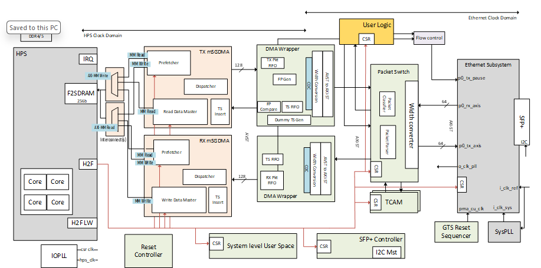

# Intel® Agilex™ 5 Ethernet System Example Design


## Description
The Ethernet System Example Design demonstrates Ethernet functionality of the Altera Agilex 5 FPGA 
supporting FTile transceivers. It provides 1-Port 10GbE and 25GbE Ethernet designs and 2-Port 10GbE / 25GbE PTP (IEEE 1588) designs leveraging the Ethernet Intel® FPGA IP

The primary components in the design are
- Hard Processor Subsystem (HPS)
- Channelized Modular scatter-Gather Direct Memory Access (MSGDMA) Subsystem
- Packet Switch module
- Packet Generator
- Ethernet MAC IP




Important features of the design include
- Ethernet Software stack running on the HPS that handles the generation of iperf traffic
- Programmable packet routing functionality handled within the Packet Switch module
- DMA engines to efficiently transfer data between the HPS and Ethernet MAC

For more information, refer to the [insert link here].


## Repository Structure

Directory structure used in this example design (every design directory has the same layout as `mk-a5e065bb32aea/ethernet`):

```bash
.
├── doc
├── dk-a5e065ab32aea
│   └── ptp                   # 2x25G PTP (IEEE 1588), Premium Development Kit
├── dk-a5e065bb32aea
│   └── ptp                   # 2x10G PTP (IEEE 1588), Premium Development Kit
├── mk-a5e065ab32aea
│   └── ethernet              # 1x25G Ethernet, Modular Development Kit
├── mk-a5e065bb32aea
│   ├── ethernet              # 1x10G Ethernet, Modular Development Kit
│   └── tse                   # 1-port Triple Speed Ethernet, Modular Development Kit
│       ├── src/              # Hardware — RTL / Qsys sources
│       ├── synth/            # Hardware — Quartus project and Makefile
│       ├── verification/     # Hardware — testbench / verification
│       └── software/         # Software
│           └── yocto_linux/  # KAS / Yocto BSP
└── scripts
    └── variant_config.sh     # Per-design settings used by build-hw.sh / build-sw.sh / CI
```

## Project Details

- **Family**: Intel® Agilex™ 5
- **Quartus Version**: 25.1
- **Development Kit**: [Agilex™ 5 FPGA E-Series 065B Modular Development Kit](https://www.intel.com/content/www/us/en/products/details/fpga/development-kits/agilex/a5e065b-modular.html)
- **Device Part**: A5ED065BB32AE6SR0
- **Yocto MACHINE**: `agilex5e`

## Getting Started

Building the design is easy with the scripts provided in the repo. Clone the repository to get the source files

```bash
$ git clone https://github.com/altera-innersource/applications.fpga.system-example-designs.agilex5-ed-ethernet.git
$ cd applications.fpga.system-example-designs.agilex5-ed-ethernet
$ git checkout <Release tag>
```

Follow the below procedure to build the hardware and the software.

| Design | Development kit | Hardware / Makefile | Software |
|--------|-----------------|---------------------|----------|
| 1x10G Ethernet | E-Series 065B Modular (`mk-a5e065bb32aea`) | [README](mk-a5e065bb32aea/ethernet/README.md) | [Yocto](mk-a5e065bb32aea/ethernet/software/yocto_linux/README.md) |
| Triple Speed Ethernet | E-Series 065B Modular (`mk-a5e065bb32aea`) | [README](mk-a5e065bb32aea/tse/README.md) | [Yocto](mk-a5e065bb32aea/tse/software/yocto_linux/README.md) |
| 1x25G Ethernet | E-Series 065B Modular (`mk-a5e065ab32aea`) | [README](mk-a5e065ab32aea/ethernet/README.md) | [Yocto](mk-a5e065ab32aea/ethernet/software/yocto_linux/README.md) |
| 2x25G PTP (IEEE 1588) | E-Series 065B Premium (`dk-a5e065ab32aea`) | [README](dk-a5e065ab32aea/ptp/README.md) | [Yocto](dk-a5e065ab32aea/ptp/software/yocto_linux/README.md) |
| 2x10G PTP (IEEE 1588) | E-Series 065B Premium (`dk-a5e065bb32aea`) | [README](dk-a5e065bb32aea/ptp/README.md) | [Yocto](dk-a5e065bb32aea/ptp/software/yocto_linux/README.md) |

### Building with make

Run the targets from the design directory. Software-only builds need `output_files/<REVISION>.core.rbf`
(produced by the hardware build, or generated from `output_files/<REVISION>.sof`).

| Design directory | Hardware + software | Software only (Yocto SD) |
|------------------|---------------------|--------------------------|
| `mk-a5e065bb32aea/ethernet` | `make mk-a5e065bb32aea-baseline-ethernet-all` | `make mk-a5e065bb32aea-baseline-ethernet-software-yocto_linux_sd-build-sw` |
| `mk-a5e065bb32aea/tse` | `make mk-a5e065bb32aea-baseline-tse-all` | `make mk-a5e065bb32aea-baseline-tse-software-yocto_linux_sd-build-sw` |
| `mk-a5e065ab32aea/ethernet` | `make mk-a5e065ab32aea-baseline-ethernet25G-all` | `make mk-a5e065ab32aea-baseline-ethernet25G-software-yocto_linux_sd-build-sw` |
| `dk-a5e065ab32aea/ptp` | `make dk-a5e065ab32aea-baseline-ptp25G-all` | `make dk-a5e065ab32aea-baseline-ptp25G-software-yocto_linux_sd-build-sw` |
| `dk-a5e065bb32aea/ptp` | `make dk-a5e065bb32aea-baseline-ptp10G-all` | `make dk-a5e065bb32aea-baseline-ptp10G-software-yocto_linux_sd-build-sw` |

`make help` in a design directory lists all targets.

### CI (GitHub Actions)

Each design has its own top-level orchestrator workflow (check-for-changes → build hardware → build software):

| Workflow | Design |
|----------|--------|
| `build_hw_sw.yml` | `mk-a5e065bb32aea/ethernet` (1x10G Ethernet) — push to `master`/tags, nightly |
| `build_hw_sw_tse.yml` | `mk-a5e065bb32aea/tse` (Triple Speed Ethernet) — push to `GSRD_PTP_ETHERNET_TESTING`, regression test |
| `build_hw_sw_ptp25G.yml` | `dk-a5e065ab32aea/ptp` (2x25G PTP) — push to `GSRD_PTP_ETHERNET_TESTING` |
| `build_hw_sw_ptp10G.yml` | `dk-a5e065bb32aea/ptp` (2x10G PTP) — push to `GSRD_PTP_ETHERNET_TESTING` |
| `build_hw_sw_ethernet25G.yml` | `mk-a5e065ab32aea/ethernet` (1x25G Ethernet) — push to `GSRD_PTP_ETHERNET_TESTING` |

Each orchestrator calls the shared `build_hardware.yml` / `build_software.yml` reusable workflows with its own
`variant` input (the design directory); per-design names and NFS paths live in `scripts/variant_config.sh`.
A push to `GSRD_PTP_ETHERNET_TESTING` starts a variant when that push changes its design, `scripts/`, or its workflow. A README-only commit does not start a build. The **Run workflow** button appears in Actions only after the workflow file is also on the default branch.
