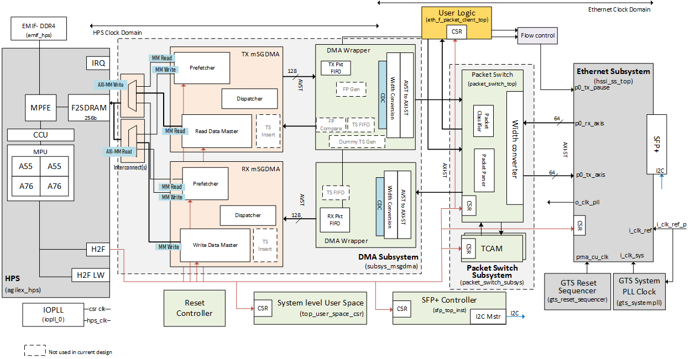

# 1-Port 25GbE Agilex™ 5 Ethernet System Example Design

The 1-Port 25GbE Agilex™ 5 Ethernet System Example Design targets the Agilex™ 5 FPGA E-Series 065A Modular Development Kit with HPS, MSGDMA, packet switch, and GTS Ethernet Hard IP.

## Description

The Ethernet System Example Design demonstrates Ethernet functionality of the Altera Agilex™ 5 FPGA supporting GTS transceivers. It provides a 1-port 25GbE/10GbE design leveraging the GTS Ethernet Hard IP.

The primary components in the design are:

- Hard Processor Subsystem (HPS)
- Channelized Modular Scatter-Gather Direct Memory Access (MSGDMA) Subsystem
- Packet Switch module
- Packet Generator
- GTS Ethernet Hard IP



Important features of the design include:

- Ethernet software stack running on the HPS that handles the generation of iperf traffic
- Programmable packet routing functionality handled within the Packet Switch module
- DMA engines to efficiently transfer data between the HPS and Ethernet MAC

## Project Details

- **Family**: Agilex 5
- **Quartus Version**: 26.1.1
- **Patch Number**: Unknown
- **Development Kit**: DK-A5E065AB32AEA
- **Device Part**: A5ED065AB32AE1V
- **Category**: HPS, Ethernet
- **URL**: https://github.com/altera-fpga/agilex5-ed-ethernet
- **Design Package**: a5e065a-mod-devkit-exp-prod.zip

## Documentations

- **Title**: Design and Build Readme
**URL**: https://github.com/altera-fpga/agilex5-ed-ethernet/blob/main/a5e065a-mod-devkit-exp-prod/README.md
- **Title**: Hardware Build (synth)
**URL**: https://github.com/altera-fpga/agilex5-ed-ethernet/blob/main/a5e065a-mod-devkit-exp-prod/src/hw/README.md
- **Title**: Software Build Readme
**URL**: https://github.com/altera-fpga/agilex5-ed-ethernet/blob/main/a5e065a-mod-devkit-exp-prod/src/sw/README.md

## Dependency

- Altera Quartus Prime Pro (see Project Details for the supported version)
- Software: [src/sw/README.md](src/sw/README.md)

## Directory structure

```text
a5e065a-mod-devkit-exp-prod/
+-- src/
|   +-- hw/                     # HARDWARE - RTL / Qsys / verification
|   |   +-- src/
|   |   +-- synth/              # Quartus project + Makefile
|   |   +-- verification/
|   +-- sw/                     # SOFTWARE
```

| Path | Role |
|------|------|
| `src/hw/src/` | RTL, Qsys, custom IP |
| `src/hw/synth/` | Quartus project and compile `Makefile` |
| `src/hw/verification/` | UVM testbench |
| `src/sw/` | Software build and artifacts |

## Compiling via Makefile (hardware and software)

The Quartus project (`top.qpf` / `top.qsf`) lives in `src/hw/synth/`.

Build instructions for this package:

- [Building the Hardware](./src/hw/README.md)
- [Building the software](./src/sw/README.md)

GSRD 2.0-style top-level Makefile targets (public stem / revision names) used in the innersource layout are:

- Public stem: `mk-a5e065ab32aea-baseline-ethernet25G`
- Hardware revision (SOF / RBF basename): `agilex5-mk-a5e065ab32aea_gsrd_ghrd_ETH_1P25G`

## Building the Hardware only

See [src/hw/README.md](./src/hw/README.md).

## Programming files (SOF + FSBL)

After software artifacts are available (`u-boot-spl-dtb.hex`):

```bash
cd src/hw/synth/
quartus_pfg -c -o hps=on \
  -o hps_path=../../sw/artifacts/u-boot-spl-dtb.hex \
  output_files/top.sof \
  output_files/top.rbf
```

See [src/hw/README.md](./src/hw/README.md) for details.

## Software

See [src/sw/README.md](./src/sw/README.md).
