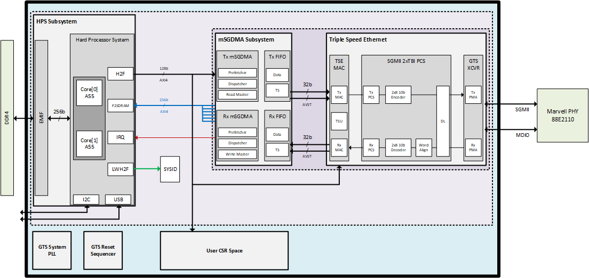

# 1-Port Triple Speed Ethernet Agilex™ 5 System Example Design

The 1-Port Triple Speed Ethernet Agilex™ 5 System Example Design targets the [Agilex™ 5 FPGA E-Series 065B Modular Development Kit (MK-A5E065BB32AEA)](https://www.altera.com/products/devkit/po-3274/agilex-5-fpga-and-soc-e-series-065b-modular-development-kit) with HPS, MSGDMA, and Triple Speed Ethernet IP with GTS PCS/PMA.

## Description

The Triple Speed Ethernet System Example Design demonstrates 10M/100M/1GbE Ethernet functionality of the Altera Agilex™ 5 FPGA. It provides a 1-port design using the Triple Speed Ethernet Intel® FPGA IP with an integrated GTS PCS/PMA (SGMII) link to the board PHY, managed over MDIO.

The Hard Processor Subsystem (HPS) runs Linux with the Altera TSE kernel driver. Packet traffic moves between HPS DDR and the MAC through a Channelized Modular Scatter-Gather DMA (MSGDMA) subsystem.

The primary components in the design are:

- Hard Processor Subsystem (HPS)
- Channelized Modular Scatter-Gather Direct Memory Access (MSGDMA) Subsystem
- Triple Speed Ethernet Intel® FPGA IP (MAC)
- GTS PCS/PMA (SGMII)
- GTS reset sequencing (`gts_reset_sequencer`, `srd_rst_ctrl`) and IOPLL clocking
- User CSR space



Important features of the design include:

- 1-port 10M/100M/1GbE via Triple Speed Ethernet MAC + GTS PCS (SGMII)
- Ethernet software stack running on the HPS (Linux + TSE driver) that handles the generation of iperf traffic
- MSGDMA datapath to efficiently transfer data between HPS DDR and the Ethernet MAC
- GTS reset sequencing and IOPLL clocking

## Project Details

- **Family**: Agilex 5
- **Quartus Version**: 26.3
- **Patch Number**: Unknown
- **Development Kit**: [MK-A5E065BB32AEA](https://www.altera.com/products/devkit/po-3274/agilex-5-fpga-and-soc-e-series-065b-modular-development-kit)
- **Device Part**: A5ED065BB32AE4S
- **Category**: HPS, Ethernet
- **URL**: https://github.com/altera-fpga/agilex5-ed-ethernet
- **Design Package**: mk-a5e065bb32aea-tse.zip

## Documentations

- **Title**: Design and Build Readme  
  **URL**: [README.md](./README.md)
- **Title**: Hardware Build (synth)  
  **URL**: [synth/README.md](./synth/README.md)
- **Title**: Software / Yocto Build Readme  
  **URL**: [software/yocto_linux/README.md](./software/yocto_linux/README.md)

## Dependency

- Altera Quartus Prime Pro (see Project Details for the supported version)
- Software / Yocto: [software/yocto_linux/README.md](software/yocto_linux/README.md)

## Directory structure

```text
tse/
+-- Makefile / project_config.mk / swbuild_config.mk
+-- src/                        # HARDWARE - RTL / Qsys / custom IP
+-- synth/                      # HARDWARE - Quartus project + Makefile
|   +-- output_files/
+-- verification/               # HARDWARE - UVM TB
+-- software/
    +-- yocto_linux/            # SOFTWARE - see software/yocto_linux/README.md
```

| Path | Role |
|------|------|
| `src/` | RTL, Qsys, custom IP |
| `synth/` | Quartus project and compile `Makefile` |
| `verification/` | UVM testbench and regressions |
| `software/yocto_linux/` | Yocto / KAS BSP |

## Compiling via Makefile (hardware and software)

The top level Makefile is in the design root (`tse/`). The Quartus project (`top.qpf` / `top.qsf`) lives in `synth/`.

Run `make help` from `tse/` for the full target list.

**Design selection (`TSE_DESIGN`):** default / supported value is `TSE_1P` (see `software/yocto_linux/meta-custom/conf/tse-solution.inc`). The hardware revision name is `baseline_a55` (`REVISION_NAMES` in `project_config.mk`). The core RBF filename must stay `baseline_a55.core.rbf`.

Public stem: `mk-a5e065bb32aea-baseline-tse`

**Full build (hardware and software):**

```bash
make mk-a5e065bb32aea-baseline-tse-all
```

This runs the hardware build, generates the core RBF from the SOF, then runs the Yocto SD software build. If `TSE_DESIGN` is omitted, the default `TSE_1P` is used.

**Hardware build only:**

```bash
make mk-a5e065bb32aea-baseline-tse-build
```

This calls `synth/Makefile` (`make -C synth all`) and then copies `synth/output_files/top.sof`
to `output_files/baseline_a55.sof` for the install and software targets.

**Software build only**, after the hardware build generates the required SOF (core RBF is produced automatically):

```bash
make mk-a5e065bb32aea-baseline-tse-software-yocto_linux_sd-build-sw
```

This runs `quartus_pfg` to create the core RBF, then
`software/yocto_linux/build.sh <core.rbf> sd` (Make supplies the RBF path).
`kas_build.sh` copies it to `fpga-bitstream/files/baseline_a55.core.rbf`
(`REVISION` from `project_config.mk` `REVISION_NAMES`). That name must match
`FPGA_RBF_FILE` from `TSE_DESIGN` / `tse-solution.inc`.

**Install core RBF only** (SOF + `quartus_pfg` → `install/binaries/`):

```bash
make mk-a5e065bb32aea-baseline-tse-install-core-rbf
```

RBF/DTB placement, `TSE_DESIGN`, and Yocto details: [software/yocto_linux/README.md](software/yocto_linux/README.md).

## Building the Hardware only

See [synth/README.md](./synth/README.md).

## Programming files (SOF + FSBL)

`u-boot-spl-dtb.hex` comes from the Yocto deploy images after a Yocto build.

After a Yocto build:

```bash
cd synth/
quartus_pfg -c -o hps=on \
  -o hps_path=../software/yocto_linux/build/tmp/deploy/images/agilex5e/u-boot-spl-dtb.hex \
  output_files/top.sof \
  output_files/top.rbf
```

Or use the revision-named SOF produced by the top-level Makefile under `output_files/`.

## Verification (UVM)

See [verification/README.txt](verification/README.txt).

## Software

Software overview (board setup, FSBL, optional standalone kernel/ATF/U-Boot builds):  
**[software/README.md](software/README.md)**.

Yocto / KAS, `TSE_DESIGN`, RBF/DTB names, `build.sh`, binaries:  
**[software/yocto_linux/README.md](software/yocto_linux/README.md)**.
